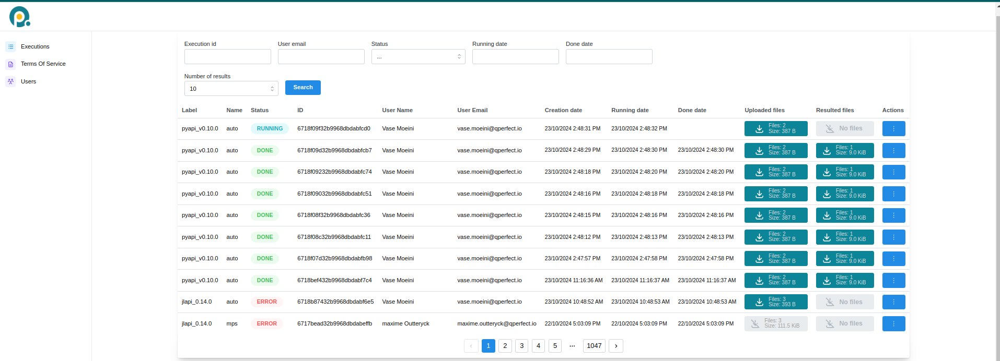

# Execution on MIMIQ

This page provides detailed information on how to execute quantum circuits on MIMIQ's remote services.
Use the following links to navigate through the sections:

## Cloud Service

MIMIQ provides remote execution of quantum circuits via its cloud services, allowing users to run quantum jobs on high-performance infrastructure. You can connect to the cloud server by providing your credentials and accessing the MIMIQ cloud URL at [https://mimiq.qperfect.io/sign-in].

### Overview

The MIMIQ Cloud Service offers multiple features for managing job executions, user roles, and organizational access. Below is a screenshot of the **Cloud Dashboard** that you will find in the server website.



### Job Management

The Job Management or Executions section provides a comprehensive view of all quantum jobs submitted. Users can track the status of their jobs, cancel jobs, retrieve results and view detailed information, including start time, completion time, and current status. For **Organization Managers**, additional features are available:

- View Other Users' Jobs: Organization managers can view jobs submitted by all users in their organization, allowing them to monitor the workload.
- Cancel Jobs: Managers also have the ability to cancel any job within their organization if necessary, providing greater control over resource management.
  
This section is essential for both tracking the progress of jobs and managing computational resources effectively.

**Job status**

The Status tab allows you to filter jobs based on their status. By clicking on the tab, you can select a specific status (e.g., NEW), and then click on the Search button to view all jobs that match the selected status.

When a job is submitted to the MIMIQ cloud services, it goes through various status stages:

- `NEW`: When a job is initially submitted, its status is marked as NEW, indicating that it has entered the queue but has not started executing yet. In this stage, the job is waiting for previous jobs in the queue to complete, whether they finish successfully or encounter errors.

- `RUNNING`: Once all prior jobs are completed, your job will begin execution, and its status will change to RUNNING. At this point, the job is actively being processed by the MIMIQ engine, either by the statevector simulator or MPS algorithm, depending on the job configuration.

- `DONE`: Upon successful completion, the job status changes to DONE, indicating that the quantum circuit has finished executing and the results are available for retrieval.

- `ERROR`: If the job encounters an issue during execution, such as exceeding the time limit or encountering hardware or software errors, its status will change to ERROR. Users can then review the error logs to diagnose the problem. You can also hover your mouse over the word `ERROR` and a short error message will appear.

**Job ID**

The ID tab shows a unique identifier for each job. This identifier can be used to retrieve results using [`getresults`](@ref), see [results](#results) section.

### Terms of Service

When an Organization Manager first connects to the server they need to accept the `Terms of Service` in order to activate the cloud subscription. The organization users will then be able to send jobs. The Terms of Service is also available for the users to read it.

### User Management

The User Management section is available exclusively to users with the Organization Manager role.

Key features of user management include:

- Adding New Users: Organization managers can invite new users to join their organization, enabling them to submit jobs. However, there is a limit to how many users can be added based on the organization’s plan.
- Role Management: Organization managers can assign roles and manage permissions within their team, ensuring that the right users have the necessary access to cloud resources.

## Connecting to server for sending jobs

In order to execute a circuit in the remote, you first need to connect to it, see also [quickstart](../quick_start.md) page.

### Connection methods

The [`connect`](@ref) function supports three calling conventions:

- `connect()` — opens a browser-based login page (**recommended**).
- `connect(token)` — authenticates with a saved refresh token.
- `connect(email, password)` — authenticates directly with credentials.

```julia
# Browser login (recommended — avoids storing credentials in scripts)
conn = connect()

# Token-based login
conn = connect("my_refresh_token")

# Credential-based login
conn = connect("john.doe@example.com", "password")
```

!!! warning
    Passing your email and password directly stores them as plain text in your script. Prefer browser login or token-based login for better security.

These calls connect to the main MIMIQ server, [`QPERFECT_CLOUD`](@ref). Pass `url` to connect to another instance, e.g. `connect(; url=QPERFECT_DEV)`.

A connection keeps its access credentials fresh in the background. Close it with `close(conn)` when you are done.

### Connection types

[`connect`](@ref) returns a connection object, which is passed as first argument to [`submit`](@ref), [`getresults`](@ref) and the job management functions below. All connection types are subtypes of [`AbstractConnection`](@ref) and work the same way with these functions.

- [`MimiqConnection`](@ref): the MIMIQ cloud service. This is what the calls above return.
- [`QhiveConnection`](@ref): the Quantum Hive services, which authenticate through their own identity provider. Select it by passing the type as first argument to `connect`.
- [`PlanqkConnection`](@ref): access through the [PlanQK](https://platform.planqk.de) platform, authenticated with a PlanQK consumer key and secret.

```julia
# Quantum Hive: browser login, refresh token, or credentials
conn = connect(QhiveConnection)
conn = connect(QhiveConnection, "my_refresh_token")
conn = connect(QhiveConnection, "john.doe@example.com", "password")

# PlanQK: explicit service URL and consumer credentials...
conn = connect(PlanqkConnection, "https://planqk.example/api", "consumer_key", "consumer_secret")

# ...or read from the PLANQK_API, PLANQK_CONSUMER_KEY and PLANQK_CONSUMER_SECRET
# environment variables (a `.env` file in the current directory is also read)
conn = connect(PlanqkConnection)
```

The keyword arguments of the Quantum Hive methods (service URL, identity provider, realm and client) are listed in the docstring of [`connect`](@ref).

### Tokens

Instead of using your credentials every time you connect to the MIMIQ services, you can authenticate once and save a token. This token can be saved to a JSON file and reused across different sessions, making it a secure and efficient way to manage authentication.

**How Token Authentication Works**:

- First Authentication: You log in once using your credentials (via browser or directly), and the token is generated.
- Saving the Token: You can save this token in a JSON file using the savetoken method.
- Loading the Token: Later, you can load the saved token with the loadtoken method to reconnect without providing your credentials again.
This is a safer method, as it avoids hardcoding sensitive information like passwords in your scripts.

After authentication, this is how it looks:

```julia
# Save the token to a file (example_token.json)
savetoken("example_token.json")

# Load the token from a saved file to reconnect
conn = loadtoken("example_token.json")
```

You can also accomplish all at once (connecting through a token if possible, otherwise connecting via the browser and then saving the token) using this code block:

```julia
conn = try
    loadtoken()
catch
    savetoken()
    loadtoken()
end
```

!!! Note
      Tokens stay valid only for one day.

## Execution

MIMIQ supports sending quantum circuits to its remote services for execution either as a **single circuit** or in **batch mode**, i.e. multiple circuits at once. In both cases, circuits are initialized in the zero state, and results are obtained by running the circuit and sampling.

You can submit one or multiple circuits for execution using the [`submit`](@ref) function, which can be called as `submit(connection, circuits; kwargs...)`. This unified interface simplifies quantum job management, whether you're running a single job or a batch of jobs.

!!! compat "Deprecation"
    The `execute` and `executeqasm` functions are deprecated. Use [`submit`](@ref) instead for all remote circuit executions.

**Parameters**:

- **connection**: The connection object used to communicate with the MIMIQ remote services.
- **circuit(s)**: A single quantum circuit or a list of circuits. These can be provided as MIMIQ [`Circuit`](@ref) objects or paths to valid `.pb`, `.qasm` or `.stim` files. See [Import and Export](import_export.md) and [circuits](circuits.md) pages.

- **kwargs...**: Additional options to customize execution:
  - **label**: A descriptive name for the simulation or batch.
  - **algorithm**: The backend method to perform the simulation: `"auto"`, `"statevector"`, or `"mps"`. The default is `"auto"`, which automatically selects between the statevector or MPS algorithm, depending on the circuit sent. See [simulation](simulation.md) page for more information.
  - **nsamples**: Number of measurement samples to generate (default: 1000, maximum: 65536). See [simulation](simulation.md) for details on sampling.
  - **bitstrings**: A list of bitstrings to compute amplitudes for. This is equivalent to adding an [`Amplitude`](@ref) operation at the end of the circuit, see [amplitudes](statistical_ops.md#amplitude) section. The results will be stored at the end of the Z-register.
  - **timelimit**: Maximum execution time in minutes (default: 30).
  - **bonddim**: Bond dimension for MPS (default: 256). See [simulation](simulation.md) page.
  - **entdim**: Entangling dimension for MPS (default: 16). See [simulation](simulation.md) page.
  - **streaming**: Whether to use the streaming simulator (default: `false`).
  - **seed**: Seed for random number generator.
  - **reorderqubits_seed**: Independent seed for the qubit reordering RNG (default: `nothing`, uses main seed). See [Simulation Parameters](simulation_parameters.md).

A [`NoiseModel`](@ref) can be passed as third positional argument, `submit(connection, circuits, noisemodel; kwargs...)`. It is applied to every circuit before upload, see [Noise Models](@ref). This works only for [`Circuit`](@ref) objects, not for file paths.

**Return type: Jobs**:

It is important to note that the [`submit`](@ref) function returns an object of type [`Execution`](@ref). This object can then be passed to other functions to get results or status updates (see [results](#results) and [job management](#job-management) sections). However, if for some reason we lose access to this object, or we simply want to connect to the same job in a different session, we can do so like this:

```julia
job = Execution("job-id")
```

Here, `"job-id"` is the unique identifier of the job, which you can find in the dashboard of the web interface, see [cloud service](#cloud-service) section.

**Example**:

```@example Execute
using MimiqCircuits # hide
str_name = get(ENV, "MIMIQCLOUD", nothing) # hide
new_url = # hide
    str_name == "QPERFECT_CLOUD" ? QPERFECT_CLOUD : # hide
    str_name == "QPERFECT_DEV" ? QPERFECT_DEV : # hide
    isnothing(str_name) ? QPERFECT_CLOUD : # hide
    str_name # hide
conn = connect(ENV["MIMIQUSER"], ENV["MIMIQPASS"]; url=new_url) # hide
# Prepare multiple circuits and execute them in batch mode # hide

# Prepare circuits
c1 = Circuit()
c2 = Circuit()

# Add gates to the circuits
push!(c1, GateX(), 1)
push!(c2, GateH(), 2)

# Execute Single circuit
job_single = submit(conn, c1; nsamples=1000, label="Single_run")

# Execute circuits in batch mode
job_batch = submit(conn, [c1, c2]; nsamples=1000, label="batch_run", algorithm="statevector")
```

## Results

After submitting executions, you can retrieve your simulation results in two different ways: through the cloud server, or from your Julia session.

!!! warning
    The job results will be deleted from the remote server after some time, so make sure to retrieve them in time. Contact your organization manager to understand how long results will be stored in the server. Note also that results will be deleted after a shorter period of time once the user has downloaded them at least once.

### Getting results (Cloud server)

You can download results directly from the cloud server web interface by clicking the box under the *Resulted files* tab, see [cloud server](#cloud-service) section. This will download a Protobuf file (`.pb`) and save it locally. The results can then be loaded to your Julia session using the [`loadproto`](@ref) function.

To learn more about Protobuf and how to save/load results, check out the [import & export](import_export.md) page, and the [saving and loading results](#saving-and-loading-results) section.

### Getting results (Julia session)

You can download results from your Julia session using two functions: [`getresult`](@ref) and [`getresults`](@ref).

`getresults` returns the results of *all* the circuits sent in a job, in the order they were submitted. `getresult` returns only the first one, and is convenient when a single circuit was sent. Both wait for the whole job to finish and download all its results.

They are both called in a similar way as `getresults(connection, execution; kwargs...)`.

**Parameters:**

- `connection (Connection)`: The active connection to the MIMIQ services, see [connection](#connecting-to-server-for-sending-jobs) section.
- `execution (Execution)`: The execution object representing the job whose results are to be fetched, see [execution](#execution) section. If you saved the output of `submit` then you can pass it to `getresults` (see example below). If you didn't save it, then you can copy the job ID from the Cloud server (see [cloud service](#cloud-service) section) and pass it to `getresults` as `Execution("job-id")`.
- `interval (Int)`: Time interval in seconds between calls to the remote to check for job completion (default: 1 second). A shorter interval results in more frequent checks, while a longer interval reduces the frequency of status checks, saving computational resources.

!!! warning
    Both `getresults` and `getresult` block further code execution until the job requested has finished. If you want to check the status of the job before attempting to retrieve results, we recommend using [`isjobdone`](@ref), see [job management](#useful-job-management-features) section.

If the whole job fails or is canceled, `getresults` throws an error with the reason given by the server. When a batch completes but some of its circuits failed, the entries of those circuits are `QCSError` objects holding the error message in their `msg` field, and the others are [`QCSResults`](@ref). Check the type before using an entry:

```julia
for (i, r) in enumerate(getresults(conn, job_batch))
    if r isa QCSError
        println("circuit $i failed: ", r.msg)
    else
        println("circuit $i: ", length(r.cstates), " samples")
    end
end
```

**Example:**

```@example Execute
using MimiqCircuits # hide
str_name = get(ENV, "MIMIQCLOUD", nothing) # hide
new_url = # hide
    str_name == "QPERFECT_CLOUD" ? QPERFECT_CLOUD : # hide
    str_name == "QPERFECT_DEV" ? QPERFECT_DEV : # hide
    isnothing(str_name) ? QPERFECT_CLOUD : # hide
    str_name # hide
conn = connect(ENV["MIMIQUSER"], ENV["MIMIQPASS"]; url=new_url) # hide
# Prepare multiple circuits and execute them in batch mode # hide

# Prepare circuits # hide
c1 = Circuit() # hide
c2 = Circuit() # hide

# Add gates to the circuits # hide
push!(c1, GateX(), 1) # hide
push!(c2, GateH(), 2) # hide

# Execute Single circuit # hide
job_single = submit(conn, c1; nsamples=1000, label="Single_run") # hide

# Execute circuits in batch mode # hide
job_batch = submit(conn, [c1, c2]; nsamples=1000, label="batch_run", algorithm="statevector") # hide

# Getting the Results
res_single = getresult(conn, job_single)
res_batch = getresults(conn, job_batch)
```

### Format of Results

Each circuit's result is a [`QCSResults`](@ref) object. Printing it shows a summary: the simulator name and version, the time spent in each stage, the fidelity estimate, the most frequent samples, and the number of executions, amplitudes and samples. Its fields hold the full data:

- **simulator**, **version**: the simulator that ran the circuit.
- **fidelities**, **avggateerrors**: fidelity and average multi-qubit gate error estimates, one per execution.
- **cstates**: the classical register of each sample, as [`BitString`](@ref)s.
- **zstates**: the Z-register of each execution.
- **amplitudes**: the amplitudes requested with the `bitstrings` keyword.
- **timings**: the time in seconds spent in each stage, with the whole run under `"total"`.

The [Analyzing Results](results.md) page describes each field and shows how to compute counts, probabilities and plots from them.

!!! note
    To understand how MIMIQ samples measurements into the classical register, check the [simulation](simulation.md) page.

Here's an example of how to access different fields:

```@example Execute
using MimiqCircuits # hide
str_name = get(ENV, "MIMIQCLOUD", nothing) # hide
new_url = # hide
    str_name == "QPERFECT_CLOUD" ? QPERFECT_CLOUD : # hide
    str_name == "QPERFECT_DEV" ? QPERFECT_DEV : # hide
    isnothing(str_name) ? QPERFECT_CLOUD : # hide
    str_name # hide
conn = connect(ENV["MIMIQUSER"], ENV["MIMIQPASS"]; url=new_url) # hide
# Prepare multiple circuits and execute them in batch mode # hide

# Prepare circuits # hide
ghz = Circuit() # hide

# Add gates to the circuits # hide
push!(ghz, GateH(), 1) # hide
push!(ghz, GateCX(), 1, 2:10) # hide

# Execute Single circuit # hide
job_single = submit(conn, ghz; nsamples=1000, label="Single_run") # hide

# Getting the Results # hide
res_single = getresult(conn, job_single) # hide

# Get fidelity
fids = res_single.fidelities
println(fids)

# Get total execution time
tot = res_single.timings["total"]
println(tot)

# Get classical registers of the first 10 samples
first_samples = res_single.cstates[1:10]
println(first_samples)
```

With the output of [`getresults`](@ref) it works the same way, except you have to access one of the circuit results, i.e. `res_batch[index]` instead of `res_single`.

### Plotting results

You can visualize the results of your circuit execution using the `Plots` package. The example below shows how to plot the results from executing a single circuit. See [Plotting](@ref) for the available options.

**Example**:

```@example Execute
using MimiqCircuits # hide
str_name = get(ENV, "MIMIQCLOUD", nothing) # hide
new_url = # hide
    str_name == "QPERFECT_CLOUD" ? QPERFECT_CLOUD : # hide
    str_name == "QPERFECT_DEV" ? QPERFECT_DEV : # hide
    isnothing(str_name) ? QPERFECT_CLOUD : # hide
    str_name # hide
conn = connect(ENV["MIMIQUSER"], ENV["MIMIQPASS"]; url=new_url) # hide
# Prepare multiple circuits and execute them in batch mode # hide

# Prepare circuits # hide
c1 = Circuit() # hide

# Add gates to the circuits # hide
push!(c1, GateH(), 1) # hide
push!(c1, GateCX(), 1, 2:10) # hide

# Execute Single circuit # hide
job_single = submit(conn, c1; nsamples=1000, label="Single_run") # hide

# Getting the Results # hide
res_single = getresult(conn, job_single) # hide

using Plots
plot(res_single)
```

### Saving and loading results

After retrieval, if you want to save the results locally, you can save them as a Protobuf file (`.pb`) using the [`saveproto`](@ref) function. You can load back the results using [`loadproto`](@ref). This format ensures minimal file size while maintaining all the necessary data.

To learn more about Protobuf and how to save/load results, check out the [import & export](import_export.md) page.

!!! note
    Results from batch simulations need to be saved one by one.

Here is an example:

```@example Execute
using MimiqCircuits # hide
str_name = get(ENV, "MIMIQCLOUD", nothing) # hide
new_url = # hide
    str_name == "QPERFECT_CLOUD" ? QPERFECT_CLOUD : # hide
    str_name == "QPERFECT_DEV" ? QPERFECT_DEV : # hide
    isnothing(str_name) ? QPERFECT_CLOUD : # hide
    str_name # hide
conn = connect(ENV["MIMIQUSER"], ENV["MIMIQPASS"]; url=new_url) # hide
# Prepare multiple circuits and execute them in batch mode # hide

# Prepare circuits # hide
c1 = Circuit() # hide
c2 = Circuit() # hide

# Add gates to the circuits # hide
push!(c1, GateX(), 1) # hide
push!(c2, GateH(), 2) # hide

# Execute Single circuit # hide
job_single = submit(conn, c1; nsamples=1000, label="Single_run") # hide

# Execute circuits in batch mode # hide
job_batch = submit(conn, [c1, c2]; nsamples=1000, label="batch_run", algorithm="statevector") # hide

# Getting the Results # hide
res_single = getresult(conn, job_single) # hide
res_batch = getresults(conn, job_batch) # hide

# Saving Single Result
saveproto("res_single.pb", res_single)

# Saving Batch Result (Should be saved one by one)
saveproto("res_batch_1.pb", res_batch[1])

# Loading Results
loadproto("res_single.pb", QCSResults)
loadproto("res_batch_1.pb", QCSResults)
```

## Useful Job Management Features

MIMIQ provides several functions to facilitate job management. For this you need to have a connection established, and possibly a job id or object (see [connection](#connecting-to-server-for-sending-jobs) and [execution](#execution) sections).

### Check job status

You can check the status of jobs using [`isjobdone`](@ref), [`isjobfailed`](@ref), [`isjobcanceled`](@ref), [`isjobstarted`](@ref). These functions check whether the job's status is `DONE`/`ERROR`/`CANCELED`, `ERROR`, `CANCELED`, or not `NEW`, respectively, and return a boolean.

You can find this information also in the cloud server, but doing it from within the Julia session allows you to perform different actions depending on job status. It is particularly useful to avoid a call to `getresults` to take too long because a job has not finished yet (check [results](#results) section).

To call them, we simply do:

```julia
isjobdone(connection, job)
isjobfailed(connection, job)
isjobcanceled(connection, job)
isjobstarted(connection, job)
```

You can also get detailed information about a job using [`requestinfo`](@ref):

```julia
info = requestinfo(connection, job)
```

This returns a `Dict` containing full execution details such as `status`, `name`, `label`, `creationDate`, `runningDate`, `doneDate`, `errorMessage`, and file metadata.

### Cancel a job

You can cancel a running or pending job using [`stopexecution`](@ref):

```julia
stopexecution(connection, job)
```

If the job is `NEW`, it will be immediately canceled. If it is `RUNNING`, a stop signal will be sent to the executor.

### Delete job files

You can delete the uploaded and result files associated with a job using [`deletefiles`](@ref):

```julia
deletefiles(connection, job)
```

### List all jobs

You can get a list of all job requests sent to MIMIQ's cloud server using [`requests`](@ref). This can be useful for monitoring job history and active requests.

This function accepts several options, which you can use to filter by `status` (i.e. `"NEW"`, `"RUNNING"`, `"ERROR"`, `"CANCELED"`, `"DONE"`) or by `userEmail`. You can also change the limit for the amount of requests retrieved using `limit`.

Here's an example to get the last 100 new jobs:

```julia
requests(connection; status = "NEW", limit = 100)
```

You can also print the list in a formatted tree structure using [`printrequests`](@ref):

```julia
printrequests(connection; status = "RUNNING")
```

### Download files

You can download the input files or results of a job directly using [`downloadjobfiles`](@ref) and [`downloadresults`](@ref):

```julia
# Download input files
downloadjobfiles(connection, job)
downloadjobfiles(connection, job, "my_directory/")

# Download result files
downloadresults(connection, job)
downloadresults(connection, job, "my_directory/")
```

Both return a `Vector{String}` of downloaded file paths. Files are saved to `./{execution_id}/` by default.

!!! note
    For most use cases, [`getresults`](@ref) and [`getinputs`](@ref) are more convenient as they download, parse, and return the results/circuits directly.

### Get inputs

You can retrieve the input circuits and parameter files for every job using [`getinput`](@ref) or [`getinputs`](@ref). The former fetches the data of the first circuit in the job, whereas the latter retrieves all inputs from all circuits in the job (useful in batch mode). This is similar to `getresult` vs `getresults`.

```julia
circuits, parameters = getinputs(connection, job)
```
